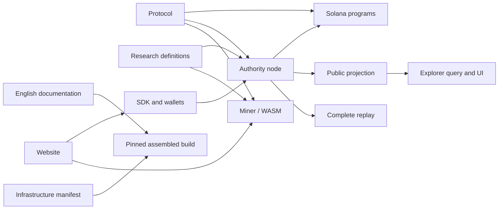

# flybrainlabs repository architecture

The project is maintained by `flybrainlabs` in ten repositories. The ownership
boundary separates code, not scientific identities or historical accounting.
Every build input has exactly one owner in `component.json`.

| Repository | Responsibility | Main consumers |
| --- | --- | --- |
| [web](https://github.com/flybrainlabs/web) | Product website, atlas, public pages and export | Website visitors |
| [node](https://github.com/flybrainlabs/node) | Authority, archives, replay coordination, product and service APIs | Miner, SDK, projection writer |
| [miner](https://github.com/flybrainlabs/miner) | Native/WASM simulation, browser workers, storage and mining workflow | Browser miner, native replay |
| [explorer](https://github.com/flybrainlabs/explorer) | Public projection, independent query process and Explorer UI | Public readers |
| [protocol](https://github.com/flybrainlabs/protocol) | Versioned identity, receipt, task and financial primitives | Node, miner, SDK, contracts |
| [contracts](https://github.com/flybrainlabs/contracts) | Solana campaign and economic settlement programs | Authorized settlement clients |
| [sdk](https://github.com/flybrainlabs/sdk) | Codecs, wallet integration, request clients and outbox | Website, tools, developers |
| [infra](https://github.com/flybrainlabs/infra) | Dependency pins, workspace assembly, publication and operations | Maintainers and operators |
| [research](https://github.com/flybrainlabs/research) | Model preparation, calibration, task definitions and evaluation | Miner and scientific reviewers |
| [docs](https://github.com/flybrainlabs/docs) | English architecture, protocol, status and runbooks | Contributors and operators |

## Build boundary

The initial split preserves existing relative imports and crate names. The
infrastructure assembler reads each component map and materializes a disposable
workspace. This keeps cross-component includes, browser imports and test vectors
working without independently copying protocol or engine code into each Git
repository. Standalone component clones require their pinned dependencies before
building. The root Rust package remains `flypow`; changing source ownership does
not change its public types or numerical outputs.

The manifest pins nine dependency commits. The infrastructure commit containing
the manifest pins the assembler itself, avoiding a circular self-hash. A release
is identified by that infrastructure commit plus its dependency manifest.
Working-tree mode is explicit and cannot be mistaken for a reproducible release.

## Trust and state boundaries

- Browser miners search frozen tasks; controlled nodes completely replay submitted
  backgrounds and determine the unique valid winner.
- One operator with three keys is not three independent operators. Open validator
  installation, staking and multiple operators remain future work.
- The Explorer query process reads only a public projection. It cannot read
  private candidates, salts, customer requests or signing keys.
- Publication is explicit. Raw events, display samples and private archives are
  distinct objects. A browser view never creates a new simulation claim.
- Scientific completion, accepted contribution and finalized asset payment are
  separate states linked by stable identifiers.
- V1 Submission remains 1,024 bytes. New Marketplace and service objects use
  separate schemas and cannot overwrite historical fields.

## Financial boundary

FBW service consumption will use a complete, verified asset identity rather than
a symbol. The host-tested service domain enforces finite allowances, reservations,
refund upper bounds, stable entitlements and aggregate vault coverage. These
primitives are not a deployed Marketplace contract. The existing V2 issuance and
finite-budget program is preserved; service operations do not gain mint authority.
Production addresses, budgets, acquisition channels and payments remain disabled.

## Data ownership

The repositories contain source, public descriptors and fixed identity fixtures.
Full datasets, models, generated release bundles, browser profiles, databases,
private artifacts and keys remain in external persistent locations. Repository
assembly and publication never reset them. Scientific descriptors may contain
historical multilingual strings because their exact bytes are hashed; English
documentation must not silently rewrite those identifiers.
