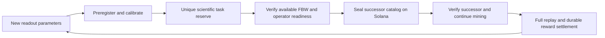

# Continuous task supply for the V4 mining factory

## Selected behavior

An explicitly started mining session should continue across task transitions.
The selected long term supply design prepares calibrated scientific tasks ahead
of demand, freezes funded successor catalogs, and switches miners to a verified
successor without discarding their wallet, model, results or earned rewards.
It cannot promise unlimited paid work with finite funds or unmeasured verifier
capacity.

This diagram describes the selected supply design. The complete successor
registration, discovery and switching path is **not deployed** in the current
V4 service.

## Current behavior and concrete limits

The activated catalog has eight frozen tasks. `Factory::append` accepts only a
draft factory; a running or exhausted catalog cannot be extended. A permanent
science marker prevents paying the same scientific task in another catalog.
Changing a label, seed, calibration label or catalog ID does not create a new
scientific identity.

The browser now recovers eligible frozen tasks automatically only while an
explicitly started session remains active. It finalizes an eligible verified
candidate before expiry, preserves earlier candidates' deadlines, and stops new
sends on Pause, Lock, insufficient SOL, missing personal RPC or an ambiguous
receipt. Starting during a closed claim window can enter standby without CPU
work or another signature. Existing verification deadlines still apply.

This recovery feature reopens an allowed attempt or advances an existing task.
It does not create a new catalog or remove the eight-task limit.

## Calibrated reserve prepared on 2026-10-19

The reproducible `tools/calibrate_factory_reserve_v4.py` tool selects disjoint
downstream populations by anatomical stimulus weight before evaluating them.
It excludes all 31 historical goals and all eight registered V4 goals, retains
the existing complete model, and independently evaluates new readout predicates
against matching complete event archives. Descriptions are not novelty inputs.

The first reserve contains 16 distinct eligible descriptors. Each used 20
preregistered inputs, including eight held-out inputs; each had eight passing
inputs and two held-out successes with two public backgrounds. Descriptor and
scientific identity validation passed. No new native run or model download was
needed because all simulation inputs matched retained complete event archives.
These correlated simulator readouts are development calibration evidence, not
independent biological discoveries, a large-miner load test or mined rewards.

The reserve is unregistered and unfunded. Its raw events and preregistration
evidence remain outside source repositories. Following generations must include
all registered and previously reserved science in their historical inventory.
An exhausted anatomical selection envelope requires a reviewed new template;
the generator must not silently recycle goals or tune thresholds to outcomes.

## Implemented pool source and activation boundary

The pool source now includes a PostgreSQL dispatcher with exclusive server-time
leases, fencing, immutable jobs and signed transaction outboxes. Approved plans
register and seal separate V4 factories. A signed manifest binds their authority,
program, genesis, mint, policy, scientific envelope and frozen catalog roots.

The browser includes authenticated input assignments and a safe catalog switch
that updates the reader, scoped signer, Worker capability and candidate store
together. Previous contexts retain their archives and reconcile submissions and
rewards. Valid candidates finalize before task expiry/retry. SSE notifications
are hints; personal RPC remains the browser's chain authority.

The supply worker can run the exact approved calibration generator against a
frozen complete historical inventory, validate its held-out evidence and import
the resulting catalog within an explicit finite aggregate reward authorization.
It never automatically creates that authorization or mints funds. Calibration
and registration pause under replay/archive backpressure. The local mining
wallet continues without a spending budget.

This source implementation has passed local queue, VM and browser acceptance. It
is not enabled on the
original node. Its private runtime is still unreadable to the current account.
The website's public task-pool trust configuration also remains inactive. The
existing single-catalog service and its frozen deadlines still apply until an
authorized administrator completes the documented deployment gate.

See [Factory pool operations](FACTORY_POOL_V4_OPERATIONS.md) for installation,
finite funding, retained-data recovery and the capacity acceptance procedure.
Full-model throughput at the target miner scale and real personal-RPC acceptance
remain separate gates. Queue tests, VM transactions and fixture-backed browser
checks do not establish either outcome.
