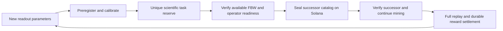

# Continuous task supply for the V4 mining factory

## Selected behavior

An explicitly started mining session should continue across task transitions.
The selected long term supply design prepares calibrated scientific tasks ahead
of demand, freezes funded successor catalogs, and switches miners to a verified
successor without discarding their wallet, model, results or earned rewards.
It cannot promise unlimited paid work with finite funds or unmeasured verifier
capacity.

The successor registration, signed discovery and switching path is deployed on
the original Devnet node. The r13 website enables its pinned task-pool trust.
The original eight-task anchor and two new 16-task catalogs retain their own
immutable rules and accounting.

## Current behavior and concrete limits

The original anchor catalog has eight frozen tasks. `Factory::append` accepts only a
draft factory; a running or exhausted catalog cannot be extended. A permanent
science marker prevents paying the same scientific task in another catalog.
Changing a label, seed, calibration label or catalog ID does not create a new
scientific identity.

The browser now recovers eligible frozen tasks automatically only while an
explicitly started session remains active. It finalizes an eligible verified
candidate before expiry, preserves earlier candidates' deadlines, and stops new
sends on Pause, Lock, insufficient SOL, missing personal RPC or an ambiguous
receipt. Starting during a closed claim window can enter standby without CPU
work or another signature. Existing verification deadlines still apply.

Recovery reopens an allowed attempt or advances an existing task. The separate
pool supply service creates new approved catalogs, and the browser switches
between them without waiting for an unrelated closed anchor window.

## Calibrated reserve prepared on 2026-10-19

The reproducible `tools/calibrate_factory_reserve_v4.py` tool selects disjoint
downstream populations by anatomical stimulus weight before evaluating them.
It excludes all 31 historical goals and all eight registered V4 goals, retains
the existing complete model, and independently evaluates new readout predicates
against matching complete event archives. Descriptions are not novelty inputs.

The first reserve contains 16 distinct eligible descriptors. Each used 20
preregistered inputs, including eight held-out inputs; each had eight passing
inputs and two held-out successes with two public backgrounds. Descriptor and
scientific identity validation passed. No new native run or model download was
needed because all simulation inputs matched retained complete event archives.
These correlated simulator readouts are development calibration evidence, not
independent biological discoveries, a large-miner load test or mined rewards.

This reserve was initially unregistered and unfunded. The owner subsequently
authorized a finite 6,400 FBW Devnet pool allocation, and its 16 descriptors now
form the first successor catalog. Raw events and preregistration evidence remain
outside source repositories. Following generations include all registered and
previously reserved science in their historical inventory.

The reviewed `overlapping-readouts-v1` template preregisters lexicographic
12-cell combinations from 64 anatomically ranked cells before evaluation. It
excludes stimulus/off-target populations and every prior scientific identity.
Readout overlap is disclosed as correlated development work. Its first 16 goals
each passed qualification over 20 inputs, including eight held-out inputs and
two held-out successes, after excluding 55 historical identities. A further
unfunded review iteration excluded all 71 preceding identities and produced a
different qualified goal. Thresholds and simulation definitions were unchanged.
The first 16 generated goals form the second successor catalog. Both catalogs
are finalized and discoverable through the authority-signed manifest.

## Implemented pool source and activation boundary

The pool source now includes a PostgreSQL dispatcher with exclusive server-time
leases, fencing, immutable jobs and signed transaction outboxes. Approved plans
register and seal separate V4 factories. A signed manifest binds their authority,
program, genesis, mint, policy, scientific envelope and frozen catalog roots.

The browser includes authenticated input assignments and a safe catalog switch
that updates the reader, scoped signer, Worker capability and candidate store
together. Previous contexts retain their archives and reconcile submissions and
rewards. Valid candidates finalize before task expiry/retry. SSE notifications
are hints; personal RPC remains the browser's chain authority.

The supply worker can run the exact approved calibration generator against a
frozen complete historical inventory, validate its held-out evidence and import
the resulting catalog within an explicit finite aggregate reward authorization.
It never automatically creates that authorization or mints funds. Calibration
and registration pause under replay/archive backpressure. The local mining
wallet continues without a spending budget.

The original node now runs the persistent pool service with PostgreSQL 16,
scoped private signer configuration and one shared native lane for calibration
and replay. Installation, source hashes, coherent backups, service restart and
an actual rollback to the original service followed by pool restoration were
verified. Signed packets and existing archives were retained.

## Actual Devnet acceptance

A controlled SDK wallet completed fresh full-model computation and authenticated
commit/upload/reveal in both successor catalogs. Two verifier identities each
performed both complete native backgrounds for each candidate. Both tasks paid
200 FBW, the controlled wallet's finalized balance increased by 400 FBW, and both
catalogs advanced automatically to their next task. The controlled wallet paid
9,133,360 lamports across both complete acceptance flows. This aggregate includes
PDA rent and transaction fees; the interface obtains the current per-operation
amounts from RPC rather than treating this aggregate as a fixed price.

The original host has two logical CPUs and approximately 1 GiB of RAM. A measured
complete native background took about 14-15 seconds with approximately 298 MiB
of peak resident memory. Capacity for a large miner population remains
unmeasured. Native replay, verification backpressure and disk reserve remain
bounded.

The 6,400 FBW allocation funded 32 new tasks; two were used for acceptance.
Fully allocated project rewards pause preparation of additional catalogs while
already funded computation and settlement continue. This project reward limit
is separate from the mining wallet, which has no spending budget. Further reward
authorization remains an explicit operator action.

See [Factory pool operations](FACTORY_POOL_V4_OPERATIONS.md) for installation,
finite funding, retained-data recovery and the capacity acceptance procedure.
Full-model throughput at the target miner scale and real user personal-RPC browser
acceptance remain separate gates. Browser wallet and cross-catalog Worker checks
use explicit RPC/login fixtures. The live SDK acceptance used the retained node
RPC and a controlled signer. External wallet extension confirmation,
physical-device acceptance and independent operators remain separate checks.
