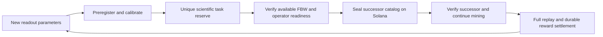

# Continuous task supply for the V4 mining factory

## Selected behavior

An explicitly started mining session should continue across task transitions.
The selected long term supply design prepares calibrated scientific tasks ahead
of demand, freezes funded successor catalogs, and switches miners to a verified
successor without discarding their wallet, model, results or earned rewards.
It cannot promise unlimited paid work with finite funds or unmeasured verifier
capacity.

This diagram describes the selected supply design. The complete successor
registration, discovery and switching path is **not deployed** in the current
V4 service.

## Current behavior and concrete limits

The activated catalog has eight frozen tasks. `Factory::append` accepts only a
draft factory; a running or exhausted catalog cannot be extended. A permanent
science marker prevents paying the same scientific task in another catalog.
Changing a label, seed, calibration label or catalog ID does not create a new
scientific identity.

The browser now recovers eligible frozen tasks automatically only while an
explicitly started session remains active. It finalizes an eligible verified
candidate before expiry, preserves earlier candidates' deadlines, and stops new
sends on Pause, Lock, insufficient SOL, missing personal RPC or an ambiguous
receipt. Starting during a closed claim window can enter standby without CPU
work or another signature. Existing verification deadlines still apply.

This recovery feature reopens an allowed attempt or advances an existing task.
It does not create a new catalog or remove the eight-task limit.

## Calibrated reserve prepared on 2026-10-19

The reproducible `tools/calibrate_factory_reserve_v4.py` tool selects disjoint
downstream populations by anatomical stimulus weight before evaluating them.
It excludes all 31 historical goals and all eight registered V4 goals, retains
the existing complete model, and independently evaluates new readout predicates
against matching complete event archives. Descriptions are not novelty inputs.

The first reserve contains 16 distinct eligible descriptors. Each used 20
preregistered inputs, including eight held-out inputs; each had eight passing
inputs and two held-out successes with two public backgrounds. Descriptor and
scientific identity validation passed. No new native run or model download was
needed because all simulation inputs matched retained complete event archives.
These correlated simulator readouts are development calibration evidence, not
independent biological discoveries, a large-miner load test or mined rewards.

The reserve is unregistered and unfunded. Its raw events and preregistration
evidence remain outside source repositories. Following generations must include
all registered and previously reserved science in their historical inventory.
An exhausted anatomical selection envelope requires a reviewed new template;
the generator must not silently recycle goals or tune thresholds to outcomes.

## Required service work before activation

1. Add a persistent batch dispatcher with an exclusive lease and immutable
   request receipts. Restarting after an uncertain transaction must reconcile
   the same catalog and signed transaction, without publishing a duplicate.
2. Maintain a reserve ahead of observed consumption. Size it using measured
   task completion and calibration time; a fixed count alone does not establish
   capacity for many miners. Pause publication under replay or archive pressure.
3. Register unique task markers and seal a successor factory before the current
   catalog drains. Allocate only available, authorized FBW. Preserve accepted
   unpaid rewards and close old accounting only after reconciliation.
4. Publish a verifiable predecessor/successor relation bound to the same
   authority, program, genesis, mint, policy and approved calibration envelope.
   Miners must verify it from finalized chain state. A changed HTTP URL alone
   cannot authorize another factory to spend from an unlocked wallet.
5. Switch the browser reader, scoped signer, Worker read capability and
   candidate store together at a safe boundary. Keep previous stores, receipts,
   pending submissions and reward claims recoverable.
6. Admit work according to actual verifier capacity. The current service has
   one serial replay lane and two trusted keys under one operator. More miners
   do not increase its throughput or establish operator independence.
7. Verify repeated catalog rollover, multiple miners, crashes, low funds,
   pending winners and backpressure before claiming continuous availability.

The original node returned `EACCES` when this session attempted to read its
private runtime configuration. No privilege escalation was attempted. No node
runtime, public catalog, contract executable or new reward budget was changed.
Activation of the supply service remains pending an authorized maintenance path
and the implementation and acceptance steps above. The wallet/balance UI release
can be deployed independently with its narrower verified scope.

Miner SOL and project FBW are separate: the local mining wallet has no spending
budget, while project reward accounting must remain solvent and prevent replay.
