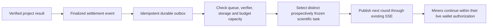

# Continuous competition with bounded task supply

Status: bounded dispatcher and continuous-participation implementation for
`continuous-task-supply-20261014-v1`. The original node still needs a new approved
calibrated catalog and a finitely funded Devnet stage. The previous scientific
plan and reward units are exhausted. No new task, calibration run, funded stage
or payment is created by installing this implementation.

## Observed condition

A fresh read of the original authority returned `RESEARCH_STAGE_COMPLETE`,
`currentRoundAvailable: false`, `round: null`, `pendingGoals: 0`,
`remainingUnopenedGoals: 0`, `roundCount: 36`, plan revision 3 and supply status
`exhausted`. The authority and verifier heartbeats were available. This establishes
task exhaustion rather than a dead node as the current supply problem.

The browser also intentionally pauses on hidden-page events, explicit time/storage
limits, lost authority connections and input-domain exhaustion. The exact reason
for an individual interruption must come from its session/log record. Waiting
for a task and pausing CPU execution should have distinct product states.

## Proposed pipeline

A chain confirmation can trigger replenishment. Use the existing project's
finalized result/settlement event, consumed once through a durable outbox. The
shared Solana chain produces blocks independently of flybrainwork computations.
Listening to every block is unnecessary for this scheduling purpose. If a frozen
protocol uses a finalized block hash as an entropy input, that input is part of
the prospective identity and rule definition; changing a nonce or block hash
does not create a distinct scientific discovery goal.

## Bound work rather than total runtime

An initial operating window could allow one current goal, four queued goals and
replenishment below two queued goals. These are proposed limits to tune using
observed throughput, not activated configuration. The queue should contain small
task descriptors and references to cached model/profile/calibration bytes.

Prepare calibrated templates and distinct experimental objectives ahead of time.
Each issued task must have a unique `ScientificTaskId`, frozen parameters,
evaluation rules and an authorized finite budget. A template can reduce repeated
setup work; its calibration cannot be assumed to validate arbitrary new scientific
conditions. Covered or solved objectives retain their completion state.

No-open-task periods preserve the miner's chosen continuous-participation intent,
model, OPFS artifacts and submission state while using no simulation CPU. A new
round is entered only after checking live wallet identity, grants, deadlines,
resource limits and the round's frozen funding. A user's explicit stop remains a
stop. Exhausted funds or storage do not silently renew themselves.

## Keep the original node's pressure controlled

- Consume one confirmed project event stream, with durable cursors and reconnect
  reconciliation; broadcast state changes through the existing SSE channel.
- Keep browser polling as a low-frequency fallback with jitter and backoff.
- Apply verifier and archive-capacity backpressure before opening more rounds.
- Run inexpensive identity, signature, size, commitment and duplicate checks
  before admission to the bounded full-model verification queue.
- Preserve full replay, step boundaries, commit/reveal, unique-winner and receipt
  verification; an object hash does not replace scientific computation.
- Retain required evidence and backups. Add storage capacity or explicit archival
  policy before its reserved-space boundary, without deleting cached user work.
- Use a persistent Node/CLI miner for long-duration operation. A mobile browser
  cannot guarantee CPU time while backgrounded or suspended by its operating system.

Scheduling overhead can be kept small and bounded. Additional valid computations
and complete scientific verification still consume resources, so the total node
load cannot be promised to remain identical.

## Implementation order and acceptance

1. Freeze a new scientific plan and finite funding; do not reuse the consumed
   two-unit test budget or change completed task identities.
2. Add a durable, idempotent replenishment dispatcher using the existing authority
   and finalized project-event integration.
3. Separate waiting, connection recovery, user stop and resource-limit pauses in
   the miner state machine; restore automatic participation only within live authority.
4. Verify queue transitions, duplicate events, chain reorganization/finality,
   disconnect/reconnect, budget exhaustion, verifier backlog and storage pressure.
5. Measure node CPU/RSS, database/WAL growth, event/poll request rate, waiting gaps
   and full replay latency over a sustained run before claiming operational continuity.

The current queue needs actual new approved work. Installing an event listener
alone cannot supply tasks from an empty scientific plan.

## Implemented dispatcher

`node/tools/continuous_task_supply.mjs` runs inside the existing wallet gateway.
It uses one connection to the authority's signed event stream, its committed
outbox for cursor recovery, and a shared 60-second fallback with jitter. It does
not subscribe to every Solana block or run calibration on the original node.
`ROUND_FINALIZED` is the authority's committed scientific result event; new
funding is checked against finalized chain state before tasks are published.
Replenishment can happen ahead of the previous payment because all issued reward
units must already belong to the approved finite stage. No reward is paid by the
dispatcher and settlement is still reconciled by the existing relayer.

The defaults allow one active goal and four announced future goals. Replenishment
starts below two unopened goals. Signed readiness must show two model-ready
verifier identities and fewer than two eligible verification jobs. Archive and
disk reserves must cover the additional goals and one complete candidate per
already announced goal. The default reserves are 256 MiB of declared archive
capacity and 2 GiB of filesystem space. Existing admission limits remain active.
Two local identities do not establish independent operators.

The reserve is an operator-signed `flybrain-continuous-task-catalog-v1` containing
at most 128 complete goal/calibration objects per catalog, a fixed stage, exact
integer reward atoms, and distinct economic and scientific task identities.
Catalogs require enabled calibration levels with training and holdout evidence.
The existing authority performs its full goal, calibration, family and identity
validation when accepting each plan revision. Renaming an existing goal cannot
create another eligible scientific objective. Already registered goals are
recorded as historical and never reissued.

The private `continuous-task-supply.sqlite` retains approved catalog hashes,
reserved/issued states, event cursors and signed outgoing requests. The outgoing
request is committed before its HTTP POST. A lost response is reconciled using
the original signed receipt or the identical request, including after restart.
An unrelated admin revision creates a reviewable conflict rather than silently
rebasing an uncertain publication. A durable lease serializes dispatchers.

An empty reserve reports `waiting-approved-tasks` and performs no simulation,
calibration, funding read or new scientific publication. An unfunded reserve
reports `waiting-finalized-budget`. Verifier and archive backpressure also remain
distinct states. These states do not renew funding, extend stage deadlines or
clear scientific archives.

## Immediate event processing

On 2026-10-15 the owner removed artificial task pacing. The local dispatcher
update removes the ten-second elapsed-time filter on signed `ROUND_FINALIZED`,
`ROUND_EXPIRED` and `FUTURE_PLAN_APPENDED` events. Relevant events recovered from
the durable outbox also trigger a check immediately, rather than waiting for the
periodic fallback. After an explicit deployment request, commit `006b875` was
installed on the original node on 2026-10-15. The installed source hash and import
graph, wallet HTTP health, retained historical rows, private configuration and
unchanged authority/verifier/community process identities passed acceptance.
Only the wallet gateway was restarted, once. The earlier deployment record above
refers to `continuous-task-supply-20261014-v1`.

This scoped server update remains unpublished in GitHub: the matching API login
required by `AGENTS.md` is unavailable. Verified release pins retain their last
remote revisions; an available fully pinned release is not claimed. Deployment
acceptance is recorded in infrastructure `docs/IMMEDIATE_TASK_SUPPLY_DEPLOYMENT.json`.
The dispatcher remains `waiting-approved-tasks` with no approved catalog or new
funded stage. The update added no scientific task or reward allocation.

A single evaluator coalesces event bursts and retains a follow-up when a new
wakeup arrives during an asynchronous check. Checks and publications never run
in parallel in this process. Signed event cursors, the persistent publication
lease, response reconciliation and idempotent outgoing requests remain in use.
Repeated events cannot issue the same task again. Shutdown drains an in-flight
check before closing its database.

The roughly one-minute fallback is a recovery mechanism, not a minimum task
interval. It is not shortened, and no per-block RPC subscription is added.
Verifier, archive, finite-funding, queue and wallet-authorization checks retain
their existing bounds. Failed scientific searches retain their frozen retry
policy; an unsuccessful attempt does not count as a valid result or new reward.
No completed round, scientific identity or historical receipt is rewritten.

This change removes a dispatcher delay. It does not implement the proposed
contract-owned task scheduler: the current contract still does not open a
successor task during settlement. That requires a versioned lifecycle extension,
approved calibrated task sources and independently measured verification costs.
An empty approved catalog or an exhausted finite budget still has an explicit
waiting state. Removing a timer creates neither task content nor funding.

Regression checks exercise successive real loopback SSE events within the old
ten-second window, duplicate event suppression, burst coalescing, an event during
an in-flight check, failure recovery and orderly shutdown. They also retain the
isolated finite-dispatcher funding, verification, archive, signature, restart and
lost-response checks. No production task, grant or payment is created by these
fixtures.

## Browser continuation

After explicit wallet sign-in and complete-model preparation, the primary action
can enter **Wait for tasks and continue** even when the scientific plan is empty.
Standby retains the model, artifacts, resource counters and participation intent.
It dispatches no Worker simulation and consumes no active-computation time.

A newly signed round is adopted after rechecking the signing identity, wallet
account/generation, live login, finite grant, frozen stage and session resources.
Missing or expired grants require a user action. Wallet changes, explicit pause,
stop, hidden-page events and time/storage boundaries never automatically restart.
Temporary authority or RPC admission failures suspend execution and may recover
after a fresh authority sync within the same live authorization. Input-domain
exhaustion waits for a different announced goal rather than pretending that a new
nonce is new scientific work. Refresh never restores CPU execution automatically.

The browser coalesces snapshot reads and event bursts. Its shared recovery poll
uses jitter and capped exponential backoff; normal standby reconciliation and
telemetry use roughly one-minute intervals. Pending settlement and completed
artifact recovery remain durable and keep their existing checks.

## Operator intake

1. Prepare and review distinct complete-model objectives and their calibration.
2. Approve the finite Devnet reward amount, stage and operation-cost cap. Register
   and finalize exactly those units through the existing funding workflow.
3. Publish the matching wallet plan and adopt it using the unchanged identity and
   permission defaults. A stage may now have 1–128 unique finite units; this does
   not expand an existing wallet grant or any token supply.
4. Sign the complete catalog with the existing plan-admin key using
   `tools/approve_task_catalog.mjs`. It refuses to create a replacement identity.
5. Atomically install the signed catalog at the configured private catalog path.
   The dispatcher detects it on its next check without another service restart.

The example configuration is
`infra/deploy/target-v2/continuous-task-supply.example.json`. The wallet runtime
uses its private `continuousSupplyConfig` path. The scoped upgrade tool backs up
the database and runtime, preserves existing rows and changes only the gateway;
the authority, verifier, community service and their identities stay in place.

## Evidence and remaining acceptance

Isolated scheduler tests cover bounded refill, calibrated identity checks,
funding/verifier/archive gates, duplicate events, durable leases, lost-response
recovery and restart. Coordinator and Chromium fixtures cover explicit standby,
new-round dispatch, temporary connection loss, manual stop and expired/changed
wallet authority. Fixtures create no production users, tasks or chain payments.

These tests do not establish a sustained full-model mining campaign, physical
Android operation or independent scientific acceptance. Current deployment has
an empty reserve. New approved tasks and a finite reward budget are still needed
before real miners can resume competition; sustained throughput and resource
growth must then be measured against actual complete replays.
