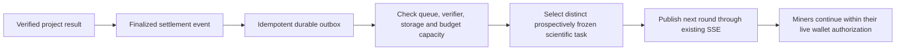

# Continuous competition with bounded task supply

Status: proposal following the owner's questions on 2026-10-14. No new scientific
tasks, calibration run, funded budget, payment or mining behavior was activated by
this investigation.

## Observed condition

A fresh read of the original authority returned `RESEARCH_STAGE_COMPLETE`,
`currentRoundAvailable: false`, `round: null`, `pendingGoals: 0`,
`remainingUnopenedGoals: 0`, `roundCount: 36`, plan revision 3 and supply status
`exhausted`. The authority and verifier heartbeats were available. This establishes
task exhaustion rather than a dead node as the current supply problem.

The browser also intentionally pauses on hidden-page events, explicit time/storage
limits, lost authority connections and input-domain exhaustion. The exact reason
for an individual interruption must come from its session/log record. Waiting
for a task and pausing CPU execution should have distinct product states.

## Proposed pipeline

A chain confirmation can trigger replenishment. Use the existing project's
finalized result/settlement event, consumed once through a durable outbox. The
shared Solana chain produces blocks independently of flybrainwork computations.
Listening to every block is unnecessary for this scheduling purpose. If a frozen
protocol uses a finalized block hash as an entropy input, that input is part of
the prospective identity and rule definition; changing a nonce or block hash
does not create a distinct scientific discovery goal.

## Bound work rather than total runtime

An initial operating window could allow one current goal, four queued goals and
replenishment below two queued goals. These are proposed limits to tune using
observed throughput, not activated configuration. The queue should contain small
task descriptors and references to cached model/profile/calibration bytes.

Prepare calibrated templates and distinct experimental objectives ahead of time.
Each issued task must have a unique `ScientificTaskId`, frozen parameters,
evaluation rules and an authorized finite budget. A template can reduce repeated
setup work; its calibration cannot be assumed to validate arbitrary new scientific
conditions. Covered or solved objectives retain their completion state.

No-open-task periods preserve the miner's chosen continuous-participation intent,
model, OPFS artifacts and submission state while using no simulation CPU. A new
round is entered only after checking live wallet identity, grants, deadlines,
resource limits and the round's frozen funding. A user's explicit stop remains a
stop. Exhausted funds or storage do not silently renew themselves.

## Keep the original node's pressure controlled

- Consume one confirmed project event stream, with durable cursors and reconnect
  reconciliation; broadcast state changes through the existing SSE channel.
- Keep browser polling as a low-frequency fallback with jitter and backoff.
- Apply verifier and archive-capacity backpressure before opening more rounds.
- Run inexpensive identity, signature, size, commitment and duplicate checks
  before admission to the bounded full-model verification queue.
- Preserve full replay, step boundaries, commit/reveal, unique-winner and receipt
  verification; an object hash does not replace scientific computation.
- Retain required evidence and backups. Add storage capacity or explicit archival
  policy before its reserved-space boundary, without deleting cached user work.
- Use a persistent Node/CLI miner for long-duration operation. A mobile browser
  cannot guarantee CPU time while backgrounded or suspended by its operating system.

Scheduling overhead can be kept small and bounded. Additional valid computations
and complete scientific verification still consume resources, so the total node
load cannot be promised to remain identical.

## Implementation order and acceptance

1. Freeze a new scientific plan and finite funding; do not reuse the consumed
   two-unit test budget or change completed task identities.
2. Add a durable, idempotent replenishment dispatcher using the existing authority
   and finalized project-event integration.
3. Separate waiting, connection recovery, user stop and resource-limit pauses in
   the miner state machine; restore automatic participation only within live authority.
4. Verify queue transitions, duplicate events, chain reorganization/finality,
   disconnect/reconnect, budget exhaustion, verifier backlog and storage pressure.
5. Measure node CPU/RSS, database/WAL growth, event/poll request rate, waiting gaps
   and full replay latency over a sustained run before claiming operational continuity.

The current queue needs actual new approved work. Installing an event listener
alone cannot supply tasks from an empty scientific plan.
