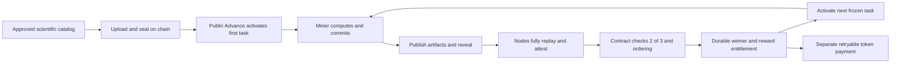

# Contract task factory V4

## Status and scope

Implemented as an opt-in versioned lifecycle on 2026-10-15 and verified on an
isolated local validator. The existing Devnet program was upgraded at finalized
slot `511257144`. The official website and original node now select V4 on
Devnet. Eight reviewed task descriptors are sealed in the contract, with
**200 FBW per winning solution and a 1,600 FBW total budget**. The first task
was opened at finalized slot `511275308`. Historical signed formats, financial
grants, receipts, archives and OPFS data are retained. No new token issuance or
mainnet activation is included.

Actual SBF acceptance is recorded by `contracts` in
`deploy/task-factory-v4/local-sbf-acceptance.json`: 20 checks, 38 successful
transactions, maximum 718 packet bytes and 138409 compute units. Its scientific
roots and signatures are explicit fixtures. Replay fault tests inject native
outcomes. These records do not establish new scientific discoveries, biological
accuracy, independent operators, physical wallets or a funded public release.

The combined verification record is
`TASK_FACTORY_V4_IMPLEMENTATION_ACCEPTANCE.json`. Eight static-export checks
passed using identical immutable resources via local hardlinks; an initial bulk
copy exceeded the small temporary filesystem. No source resource was modified.

## Source publication

The `protocol`, `contracts`, `sdk`, `node`, `miner`, `web` and `docs` source
branches were pushed and their remote commits checked using the dedicated
`flybrainlabs` GitHub SSH identity. The shared branch is
`feat/contract-task-factory-v4-20261015`. CLI/API authentication remains
unconfigured; this Git publication performs no API account operation.
The infrastructure feature branch maintains exact component pins and a
`docs/TASK_FACTORY_V4_PUBLICATION.json` receipt. Source publication does not merge
`main`, activate a public factory or fund new tasks.

## Devnet program deployment

Program `5yxjnH1PSk8iQKfK3ejG4jfSkewkTKfcpJygojdb6sam` now contains the reviewed
404944-byte SBPF v3 executable with SHA-256
`606eac05dda6210fc6cfa68f677060f3545b44aa8118983a1334c44e261a33e8`.
The intended cluster's v3 feature, existing authority and genesis were checked.
The upgrade was simulated before sending, then its finalized bytes were read
back. At upgrade time all 24 existing program-owned accounts retained their data.
Subsequent approved catalog registration changes the available miner-pool budget
counter and creates V4 accounts. The preceding
executable and private transport journals were retained outside repositories;
the upload buffer's rent was returned. Historical V3 deployment receipts remain
unchanged. Current evidence is `contracts/deploy/task-factory-v4/devnet-program.json`.

The initial inactive program deployment is preserved in
`infra/docs/TASK_FACTORY_V4_DEPLOYMENT.json`. Subsequent activation uses the
original node and website, retaining their databases, official atlas, model and
browser storage. The old node task generator and old verifier are disabled.
The shared wallet gateway retains historical operations and authenticates V4
uploads; it does not create V4 tasks or consume old rent grants.

The approved catalog contains eight distinct downstream readouts, excluding
all 31 historical scientific identities. Each was evaluated on 20 retained
complete-model input streams, including eight held-out inputs, using two fixed
public backgrounds. This preparation reused retained simulation streams and is
not new mining work or biological validation. The earlier unapproved eight-FBW
proposal is superseded by the owner's deployment and higher-reward request.
The approved finite catalog is identified by:

- Factory: `4uYEL2rErQdAUHGBggZn5dssRs95H2jHeUgXZcvhzzgL`
- Catalog root: `586813288ec9e8cd332a3f828b776e322a854f87b39f48373a2812ebbfcfa62d`
- Reward: `20000000000` atoms per winner (eight decimals).
- Total budget: `160000000000` atoms from the existing Devnet miner pool.
- Frozen claim/reveal/verification windows: 1,800 / 3,600 / 7,200 seconds.
- Maximum attempts per task: two.

The original node runs one serial native replay lane and two admitted signing
keys under one operator. These are separate complete replays, with a frozen
2-of-3 trusted-key quorum; they do not establish independent operators.

Current public Devnet evidence is `TASK_FACTORY_V4_LIVE_ACCEPTANCE.json` and the
infrastructure `docs/TASK_FACTORY_V4_ACTIVATION.json`. The first newly computed
complete-model candidate passed both backgrounds, both complete node replays
and the real wallet commit/upload/reveal flow. Two newly computed candidates each received a finalized 200 FBW payment, and
the contract atomically opened each successor. The miner ATA increased by exactly
400 FBW; task 3 is now active. An idle restart retained upload reservations, all
four complete replay decisions, signed journals, content, financial identities
and unrelated service PIDs. Finalized state and balances were unchanged after
restart, with no duplicate payment. Intermittent public-RPC errors recovered
during this bounded acceptance; a private upstream remains unconfigured.

The acceptance controller uses known calibrated inputs to bound later runs,
recomputing full Worker artifacts rather than reusing calibration archives.
Task 1's passing input was found by the existing traversal. Scripted Wallet
Standard signing occurs in a separate restricted process; private keys never
enter Chromium. This is not wallet-extension confirmation or biological validation.

## Responsibilities

| Actor | Responsibility |
| --- | --- |
| Scientific operator | Prepare distinct calibrated goals, publish complete specifications/data and approve the finite catalog and budget before activation. |
| Contract | Create/freeze catalog and task accounts, order commitments, check replay quorum, reserve rewards, accept the winner, activate the successor and pay fixed entitlements. |
| Miner | Read authoritative chain state, check content hashes, compute all backgrounds, retain artifacts, commit and reveal with the connected wallet. |
| Verification node | Retrieve committed artifacts and fully replay them. Submit a verdict; never select goals, change difficulty, generate entropy or open rounds. |
| Content providers | Serve content by hash, independently of task authority. Multiple sources are supported. |

## Lifecycle



`Append` creates all scheduled task accounts during catalog upload. `Seal`
freezes the complete ordered catalog. Preallocating accounts removes successor
rent funding and task-content generation from the acceptance transaction.

The second valid vote for the earliest eligible commitment atomically accepts
that winner and activates the supplied successor. A later verified candidate
waits behind an earlier live commitment. After that earlier candidate is rejected
or expires, anyone can call `Finalize`. No privileged relayer or successful-task
minimum interval exists in V4.

Acceptance can persist without a successor account; anyone can recover using
`Advance`. Invalid supplied accounts fail the transaction and can be omitted on
retry. Payment is separate: failure cannot erase acceptance or task advancement.
All operations require transactions; the contract is not a background scheduler.

## Frozen catalog and science

Descriptors bind scientific identity, goal ID, canonical content hash, model and
graph roots, parameter profile, calibration and input-domain hashes, reward atoms,
claim/reveal/verification windows, finite attempts and 2/4/8/16 distinct seeds.
The complete content object has schema `flybrainlabs-scientific-task-v4`, an
existing complete `GoalSpec` in `goal`, and `seeds` as sixteen-character lowercase
hexadecimal u64 strings. Model bytes and complete result archives stay off chain.

Seeds are fixed prospectively and publicly available. They permit precomputation;
this version provides neither a VRF nor fresh verifier-generated randomness.
Unpredictable challenges require a separately reviewed randomness extension.

Scientific identity matches the existing `science-task-v1` fields and domain in
`node/src/product_identity.rs`. Renaming, changing calibration labels, campaign
IDs or seeds does not create distinct science. Permanent V4 registration markers
reject duplicate catalog inclusion. The compiler also requires a historical
exclusion inventory because the contract cannot infer the private V3 database.

The ordered catalog starts with 32 zero bytes and repeatedly applies:

`SHA256("Flybrain/task-catalog/v4\0" || previous || index_u32_le || descriptor_borsh)`

Initialization fixes its final hash/count. Upload is authority-controlled and
checks order, uniqueness and total rewards; sealing requires the exact root and
count. Compact descriptors are stored directly on chain, up to 4096 tasks. This
implementation does not include a Merkle-catalog mode. A hash cannot guarantee
content availability or scientific validity; the approved source material and
calibration must be retained and available independently.

Task and registration records are not deleted on closure. Failed or abandoned
registrations cannot be disguised as new paid discovery in another campaign.
Review the complete compiled catalog before upload: this version has no descriptor
editing or administrative registration-marker reset.

## Replay, ordering and recovery

- At most eight eligible submissions occupy a task queue. This bounds verification
  capacity rather than pacing successful tasks. It does not establish Sybil
  resistance, slashing or permissionless independent verifier admission.
- Commitments bind the program, chain, policy, task/attempt, miner, beneficiary,
  candidate, result root, manifest, archive index and salt. Reveal requires a later
  slot. Copying a reveal cannot acquire an earlier eligible commitment.
- Replay signatures additionally bind the descriptor, submission PDA, commitment
  sequence/slot, verdict, report hash and complete-trial count. Distinct keys may
  vote in any order; duplicate votes count once and equivocation is rejected.
- Both positive and negative scientific votes require complete native replay of
  every required background. Missing artifacts, wrong model bytes, partial replay,
  process failure and network faults create no scientific vote.
- Verifier keys are frozen at initialization. Two admitted keys are a trusted
  quorum, not evidence of independent operators. The contract does not run the
  scientific model itself.
- Timeout retries the same task within its frozen maximum. Exhaustion records
  failure, returns the unused reservation and advances. Failure is not discovery.
- A verified valid candidate survives a missed deadline and must be finalized;
  timeout cannot discard it. Pause stops new commitments/activation but permits
  reveals, votes, acceptance and existing payout. Resume/Advance recover progress.

## Money and retained compatibility

Initialization reserves only an explicitly approved finite amount from the
existing miner pool. Every transition enforces:

`remaining + reserved + accepted_unpaid + paid + refunded = original_budget`

Activation reserves the exact descriptor reward. Acceptance fixes one immutable
winner/beneficiary and records an unpaid entitlement. Anyone can submit `Pay`,
which transfers only from the miner pool to that beneficiary's token account.
Retry pays once. Closing returns only unused funds; accepted rewards remain payable.

V4 uses explicit wallet transactions and submission-account rent. It does not
consume/renew existing V3 session grants. The operator provisions task-account
rent upfront; a miner or explicit payer funds a 768-byte submission account.
Permanent records remain on chain in this version. Rent exemption deposits are
not automatically project revenue or irreversible fees. V3's historical
1024-byte Result rent is not the V4 cost; intended-cluster costs need measurement.

The 30-day stage and aggregate 100-SOL/day miner expenditure remain planning
targets, not funds, guaranteed demand or an FBW budget. Without successful-task
pacing, a finite catalog/budget can finish before day 30. The 1,600 FBW catalog
is a bounded development allocation, not the full 30-day emission plan. Existing
grants and historical entitlements are preserved.

## Tools and integration

Run from the assembled workspace:

```sh
cargo test --locked -p flybrainlabs-mining-v3
cargo check --locked -p flypow-economy-v2-program
node tools/build_browser.mjs
node tests/task_factory_v4.mjs
node tests/factory_storage_v4.mjs
node tests/factory_gateway_v4.mjs
node tests/product_deployment.mjs
```

`compile_task_catalog_v4.mjs APPROVED_PLAN.json NEW_DIRECTORY` prepares content
and instruction bytes without signing/sending. Plans require schema
`flybrainlabs-task-catalog-plan-v4`, an approval evidence hash, factory ID, decimal
atom budget, deadline, historical exclusion inventory and task entries specifying
`specification`, `approvedCalibrationHash` and frozen `rules`. Approval metadata
is an operator declaration, not independent proof. The compiler does not create
or calibrate goals. Objects use `<sha256>.bin`, including canonical JSON content.

`sdk/tools/task_factory_v4_client.mjs` exports the PDA/transaction adapter and a
strict finalized-chain reader. `miner/web/factory-mining-v4.mjs` connects the
existing complete-model runner, separate V4 candidate store, chain reader and
commit/reveal flow. The application supplies a connected wallet, standard wallet
transaction sender and durable content publisher. Browser Solana dependencies
are included in the generated `factory-wallet-v4.mjs` bundle. Before computing,
the Worker checks `task-factory-deployment-v4.json` against finalized chain state.
The public deployment explicitly selects V4. The connected wallet signs exact
commit/reveal transactions, with original signed bytes retained in IndexedDB
before sending. Immutable content is uploaded in bounded resumable chunks,
authorized by the real wallet session, CSRF token and chain commitment.

`FactoryContentStoreV4` supports multiple sources, finite byte limits and an
injected authorized uploader, with hash checks and retrieval verification.
`LocalFactoryContentStore` reads retained local files for native replay. Other
providers use the same hash-addressed interface. Public bundles contain no
private write credentials.

`factory_verifier_v4.mjs PRIVATE_RUNTIME.json SUBMISSION_ADDRESS` verifies one
submission. Without explicit `submitVotes: true` it sends no transaction. With
`--watch`, it coalesces chain notifications, replays serially, skips already signed
work and backs off infrastructure faults. Watch mode requires a finite
`maxVoteTransactions` per-process allowance. Its one-minute fallback is recovery,
not task pacing. Native binary, verified model, content/output directories and
verifier key paths are private runtime inputs, never repository files.

The deployed original-node unit runs `factory_service_v4.mjs` with a private
runtime file. It serves a finalized read-only RPC allowlist, exact wallet-owned
V4 writes and commitment-scoped artifact uploads. A wallet login plus CSRF is
required for writes. Content is reserved against finite storage, uploaded in
one-MiB resumable chunks and hash checked before publication. CORS explicitly
admits the browser Solana client header. Content fetch functions retain their
browser receiver semantics.

One native child runs at a time. The service has one CPU core of quota, a
384-MiB memory high threshold and a 512-MiB hard limit. Verifier transactions
use persistent journals with finite fee/transaction ceilings. Payments scan
only opened, unpaid tasks; repeated genesis checks are coalesced. The gateway and verifier share one upstream lane, a 400-ms minimum RPC gap,
a finite 16-request queue and bounded read caching. Signed sends are never
cached; writes invalidate cached reads. This is resource control, not a
successful-task interval. Public RPC capacity errors remain retryable. A successful replay is never inferred from
a transport error or missing artifact.

The browser persists signed transaction bytes before sending, reconciles an
unknown send using its original signature and resumes exact upload chunks.
Frozen scheduled descriptors and paid history are cached; active tasks remain
chain authoritative. Explicit stop or refresh retains saved artifacts and
the model cache. Refresh does not automatically start CPU work.

Release `contract-factory-v4-20261015-r5` adds personal Helius Devnet RPC settings
to the mining console, including free-registration guidance, masked input,
exact network/factory checks, tab storage, explicit browser persistence and a
default reset. These preferences affect browser reads and broadcasts; node
verification retains its separately configured connection. See
[personal mining RPC](PERSONAL_MINING_RPC.md) for scope and actual test evidence.

Deployment objects require schema `flybrainlabs-task-factory-deployment-v4`,
explicit enablement, `localnet`/`devnet`, approved RPC URL, genesis hash, program ID,
policy hash, factory PDA/ID and catalog root. Readers check these bindings,
ownership, discriminators, account sizes and PDAs. The active website and
original node bind to the approved factory above. Mainnet, production payments
and formal issuance remain disabled. Extension confirmation, physical devices,
independent operators and biological prediction accuracy require their own evidence.
